# Coffee shop sales analysis

## 1.0 Introduction
The dataset contains orders from a coffeshop. It has 149,116 rows and 11 columns.

Column names: transaction_id, transaction_date, transaction_time, transaction_qty, store_id, store_location, product_id, unit_price, product_category, product_type, product_detail	

## 2.0 Objective
Analysis of the coffee shop sales data to find out:
1.	Revenue 
2.	Product performance
3.	Stores performance

## 3.0 Skills 
- Pivot tables
- Power charts
- Power query

## 4.0 Results
### 4.1 Revenue 
Total revenue : **698,812.33**

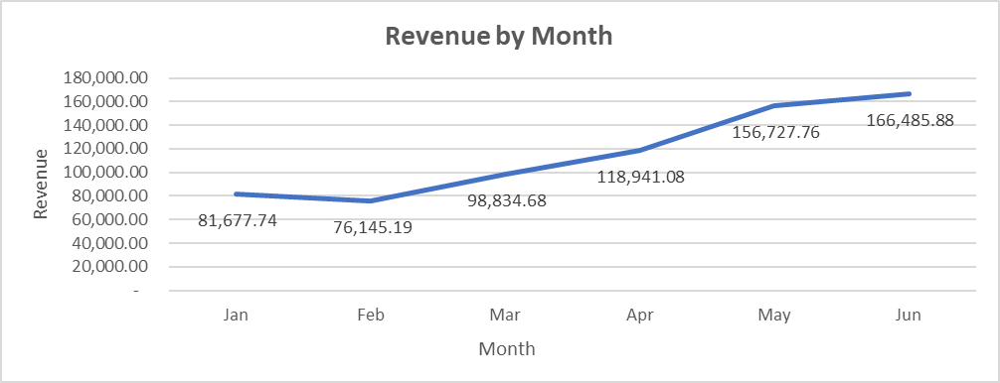
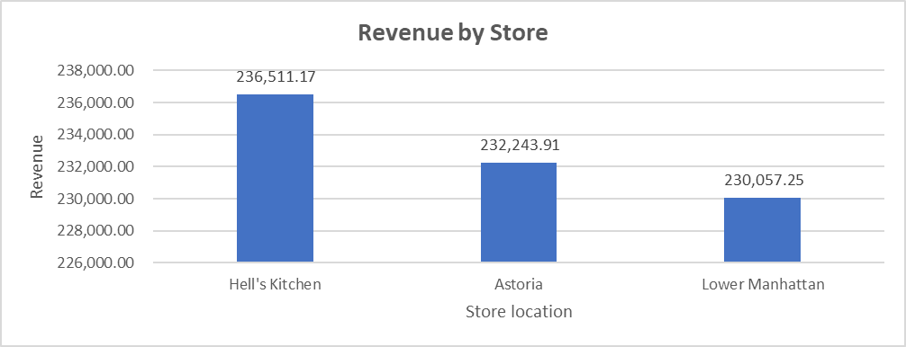 
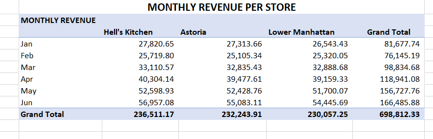

**Insights**

Revenue fell in February but kept increasing from March to June. This happened in total revenue and also in each store.

Hell's kitchen store location has the highest revenue: **236,511.17** and Lower Manhattan has the lowest: **230,057.25**.

### 4.2 Quantity sold
Total quantity sold : **214,470**

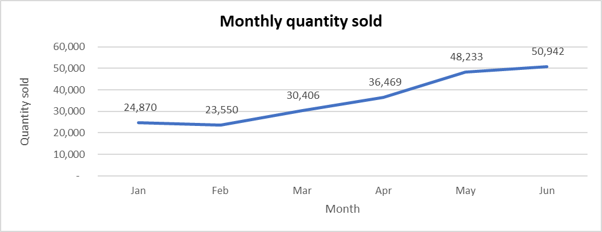
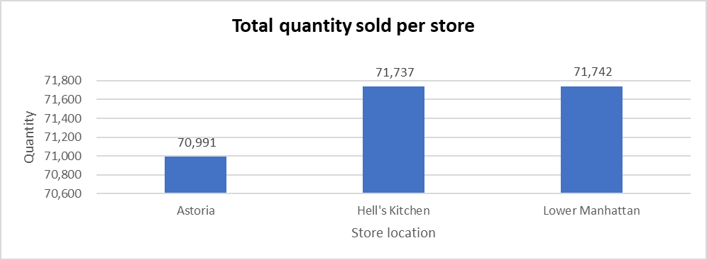 
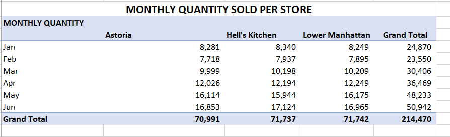

**Insights**

The quantity of products sold reduced in February but kept increasing from March to June. This happened for total quantity and also in each store.

Hell's Kitchen store location sold the most number of products: **71,737**, while Astoria sold the least: **70,991**

### 4.3 Orders
Total orders : **149,116**

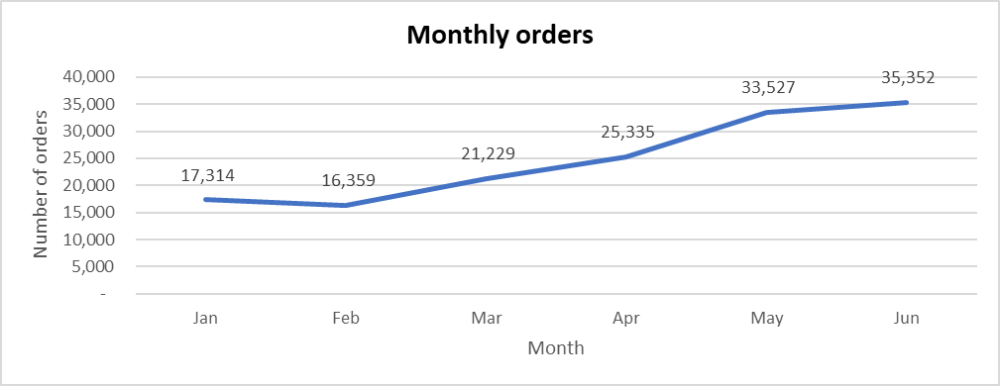
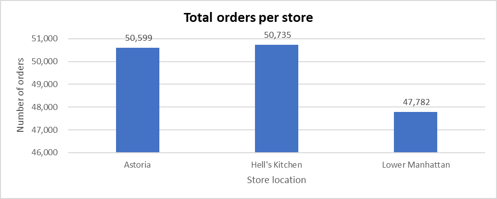
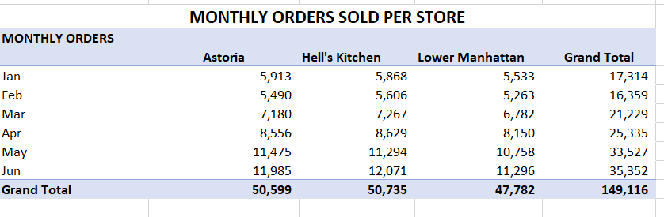

**Insights**

The number of orders fell in February but kept increasing from March to June. This happened for total quantity and also in each store.

Hell's Kitchen store location had the most number of orders: **50,735**, while Lower Manhattan had the least: **47,782**

### 4.4 Products
#### 4.4.1 Products
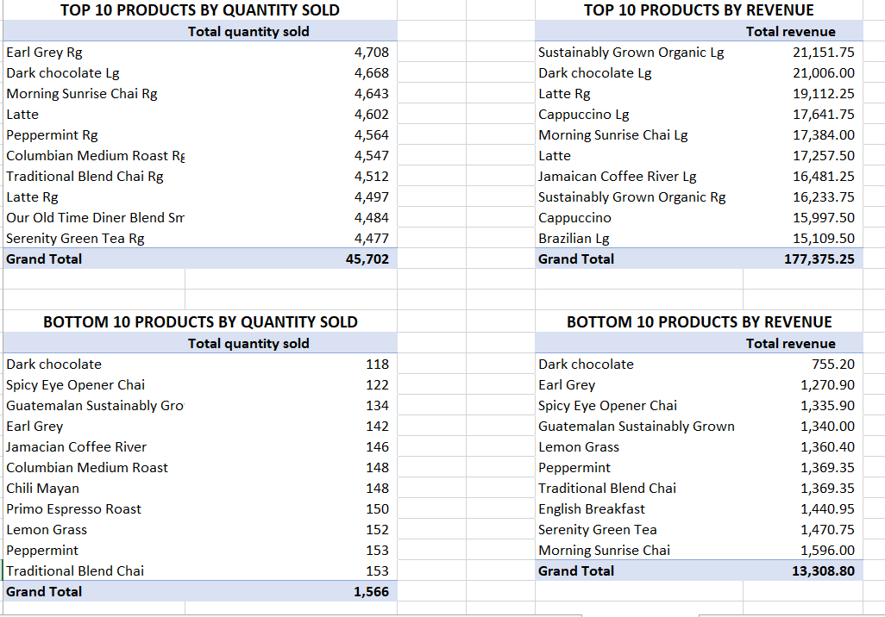
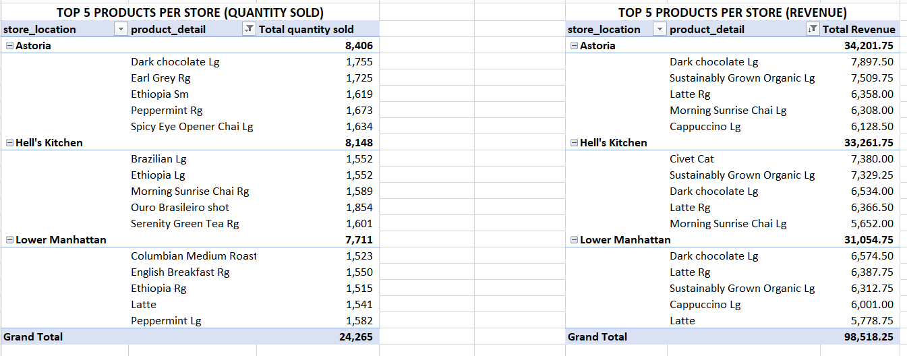
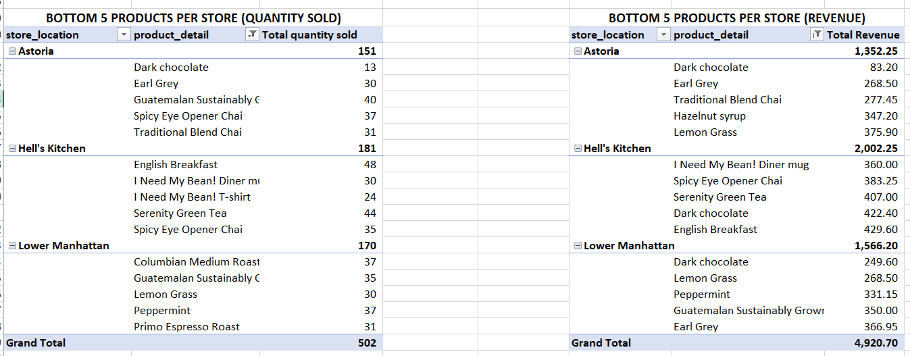

**Insights**

The bottom 10 products are making the shop very little as compared to the top 10.

The top 5 products in Astoria make more than the other locations.

The bottom 5 products in Astoria make less than the other locations.

#### 4.4.2 Products types
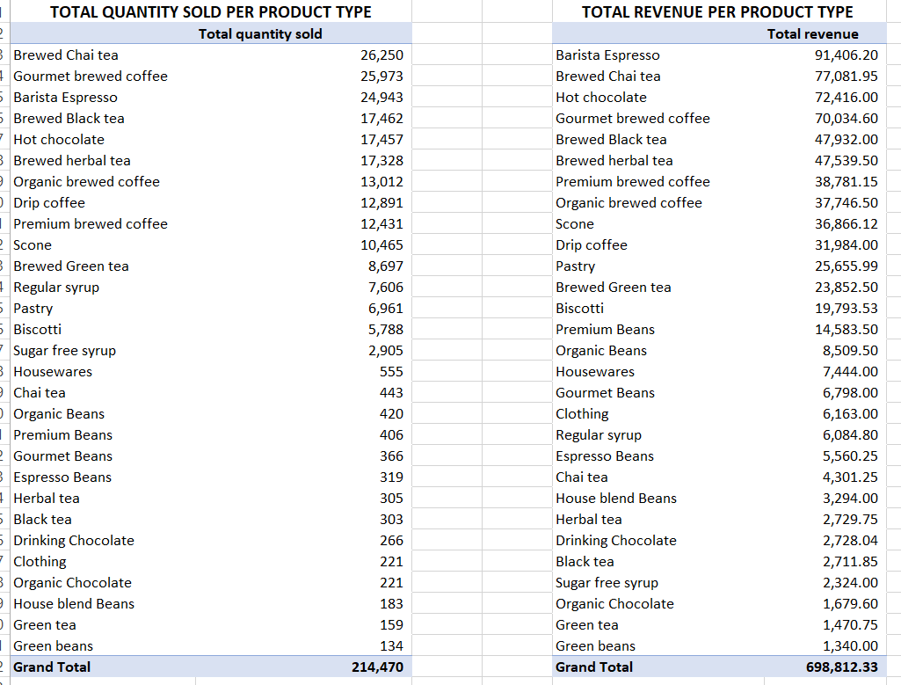
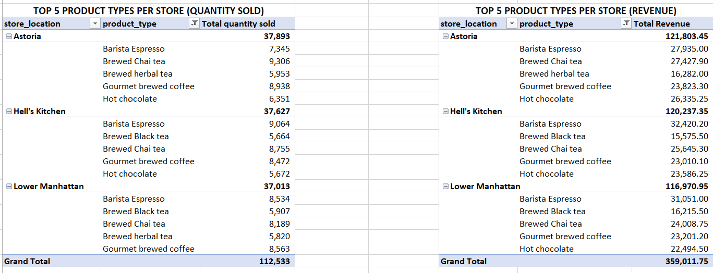
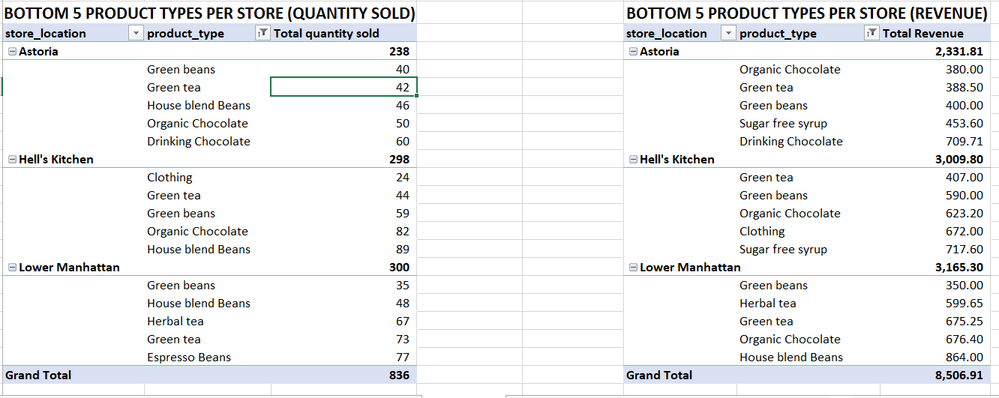

**Insights**
The top 5 product types by revenue:
- Barista Espresso
- Brewed Chai tea
- Hot chocolate
- Gourmet brewed coffee
- Brewed Black tea

The top 5 product types make significantlly more revenue than the bottom 5.

#### 4.4.3 Product category
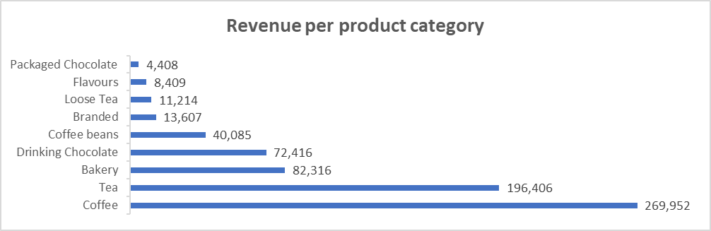
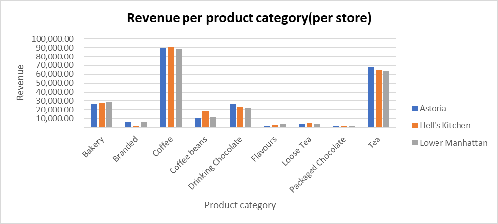

**Insights**

The top earning category is Coffee: **269,952** while the lowest is Packaged chocolate: **4,408**.

## 5.0 Dashboard
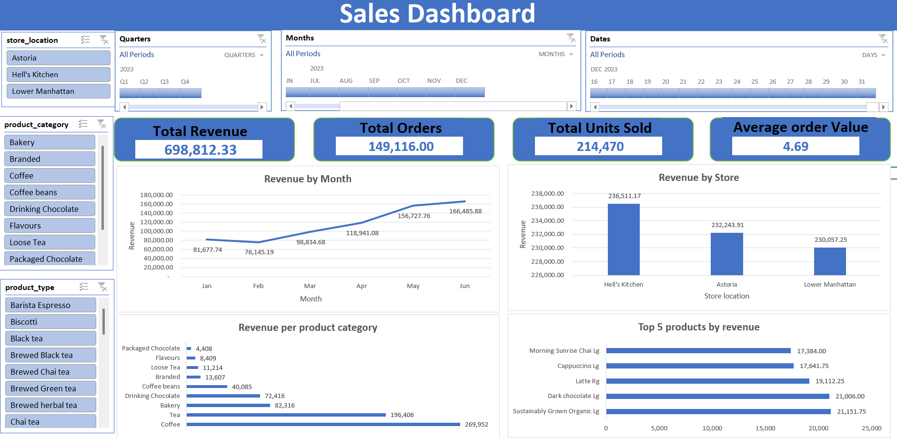

## 6.0 Insights summary
1. Revenue has been increasing from March to June.
2. Hell's kitchen sold the most number of products and had the highest revenue.
3. Lower Manhattan had the least number of orders and the least revenue.
4. The top 5 products in Astoria make more than the other locations while the bottom 5 products make less than the other locations.
5. The top 5 product types make significantlly more revenue than the bottom 5.
6. Top 10 products by revenue: 
- Sustainably Grown Organic Lg
- Dark chocolate Lg
- Latte Rg
- Cappuccino Lg
- Morning Sunrise Chai Lg
- Latte
- Jamaican Coffee River Lg
- Sustainably Grown Organic Rg
- Cappuccino
- Brazilian Lg

## 7.0 Recommendations
1. Track the products in the bottom 5 product types and look into whether the shop should keep offering them or focus on products that earn more revenue.
2. Find ways to increase orders in Lower Manhattan location.

**Link to workbook :** [Full analysis workbook](./data/processed/coffee_shop_sales_analysis.xlsx)
**Link to Raw dataset** : [Raw dataset](./data/raw/coffee_shop_sales.csv)